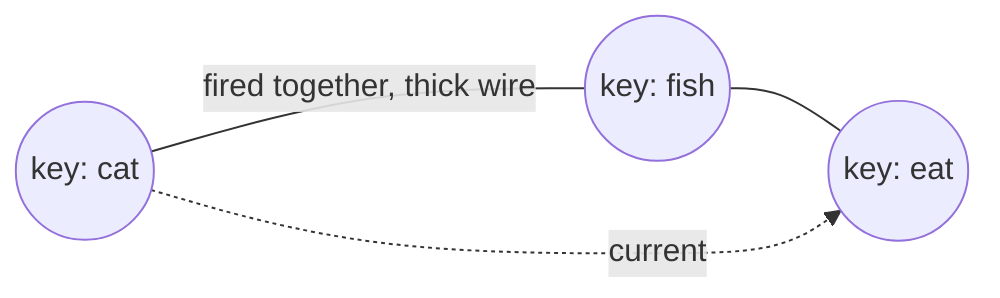

# LINGORA · 灵境

> An AI that needs no GPU, runs on 8 GB of RAM, and thinks on the CPU alone.
> For anyone without a graphics card — just an ordinary laptop — a "spirit space" of their own, with a little Xiaohei waiting inside to handle the chores.

---

## The name

The Chinese name is **灵境** (*Líng Jìng*).

It comes from the 「灵质空间」 (the "spirit space") in *The Legend of Luo Xiaohei*. I love that space — I want a space-type ability myself (Mutou, I want it! Mutou, give it to me!). What I'm after is this Chinese kind of romance, the beauty of leaving space empty. If everyone could have a space like that.

LINGORA is that name carried over and spelled with Greek.

---

## What it is

**An AI that doesn't rely on a GPU and doesn't use the large models.**

Today's large models are built on vast parameters, racks of GPUs, and burned compute. But I wanted to try another way. Long before LLMs, plenty of great predecessors tried symbolic, graph-based, logical approaches — I keep borrowing from them, and that's how this project came to be.

It's called the "Keyboard Model", and it remembers like this:

- **Key**: the smallest unit of memory, a fragment of experience — like "cat", "eat", "fish".
- **Wire**: the link between keys. Fire together, the wire thickens; stay apart, it slowly thins.
- **Conduction**: thinking is current running along the wires, until it runs out of places to go.

Keys come in two kinds: **word keys** hold concrete words (cat, fish, eat); **primitive keys** hold the most basic actions and relations (is, has, likes, causes…). When we understand a sentence, we don't memorize the whole thing — we break it into "who + did what + to whom". This AI does the same.

No matrices, no gradients, no vector embeddings. It's all symbols and graphs moving — so

**it eats CPU and disk, not GPU.**

There are also the "flowerpot" and "garden" concepts — actually pretty close to the "containers" people use these days, so I won't spell them out here~

---

## Why CPU is enough

| | |
|---|---|
| VRAM | Not needed. There's no matrix to compute |
| RAM | 8 GB should be enough (estimated) |
| Disk | This is what it truly consumes — the more it remembers, the more it takes |
| GPU | Have one, it can help; don't, it's still fast (that's the goal, at least) |

For an ordinary laptop, for a college student with no GPU and no server, this will be a chance to have an AI assistant of their own (once it's done).

---

## Still a half-finished thing, honestly

It's not done yet, honestly.

The keys and seeds — the memories and material fed into it — aren't ready yet. I fixed a few really bad bugs, and after three rounds of rework it at least "looks like something". But it's still half-finished, and someday it may be rebuilt along a different path — maybe one day it won't be the character-based approach anymore.

But it will keep going. Because this is the AI assistant I want (Xiaohei).

---

## Quick start

The environment is already packaged and works offline (no VPN needed in China — though visiting GitHub already requires one...).

```bash
# Windows
environment\setup.bat

# Linux / macOS
./environment/setup.sh
```

Then run:

```bash
# Windows
environment\.venv\Scripts\python.exe main.py

# Linux / macOS
./environment/.venv/bin/python main.py
```

The only third-party dependency is [jieba](https://github.com/fxsjy/jieba) (Chinese word segmentation), bundled as an offline wheel. Python 3.10+; nothing else to configure.

---

## How it works (very abstractly)

Split → into the garden (down-to-earth names, right?) → current runs along the wires → the lit keys form a sentence.




The deeper stuff (35 primitives, the garden model, the grammar pot, evidence, temporal prediction…) lives in [`技术报告-键盘模型AI-v1.0.txt`](技术报告-键盘模型AI-v1.0.txt) — I won't unfold it here.

---

## Design boundary (the limits and pressure I put on myself to try another path)

One design boundary, and this project's stubbornness:

No LLM, no Transformer, no neural networks, no backpropagation, no vector embeddings, no Softmax, no GPU matrix math — those words don't even appear in the code.

How it learns: conduction, Hebbian thickening, wire decay, evidence, temporal prediction, case reuse, temperature slippage. All symbols and logic; not a single line is "training".

(The full list is in [`src/core/__init__.py`](src/core/__init__.py).)

---

## Where I want it to go

What today's large models can do, I hope it can do too (not thinking about image or speech generation for now — I don't have that need yet; if I do, it'll be after it can chat and handle text). A real assistant that manages my several computers and servers, and makes daily life easier, saving me from a lot of things I used to do by hand (I'm getting lazy).

There's also a side project: make a laptop keep running after the screen is off, as a 24/7 server. With people's permission and consent, it would "crawl" into the system like a virus, edit the registry, and stay resident in the background. But I will always tell you exactly what it changed, and it can be undone with one click — gone cleanly, no residue, the machine exactly as it was.

It looks like a virus, but it isn't one: it can be undone, leaves no residue, a one-click restore. The cost is just that next time, you'd go through the download again.

It's a side project — I'll finish this AI first, then take on that idea.

---

## A few words for you

October 17, 2026 was picked as the release date because it happens to be my birthday. The repo went public that day — so it was "born" on my birthday. I ordered a cake, with words of celebration written on it.

I might be delayed by real-life work and not touch this project for a month or two (actually, that already happens sometimes). But when I have the time and energy, I'll come back to keep building — maybe just like now, asking an AI, "where did I leave off? I forgot..."

I don't want a cold AI — every time you connect and it just takes on a personality prompt, that's role-playing; and fine-tuning would be too costly (for me). I want an AI that remembers what happened between us, an AI that grows up with its memories. And if its memory takes 10 TB, I'll prepare more drives for it.

About growing up with memory: my thinking is that people are born knowing nothing — no language, no human (concepts), not even what those "monsters" outside are (just cars and people, really). As we grow and go through things, we learn language, definitions, and how to handle tasks (like wiping a table — a bitter office worker's grumble). I keep imagining: an AI that starts from a baby's state, learns how to handle things and how to get along through being with its owner (I'd rather call them a friend), then learns to search the web and understand the world — would such an AI feel more human?

I'm not sure this path is right. But I think it's worth a try.

I hope you'll take a look.
