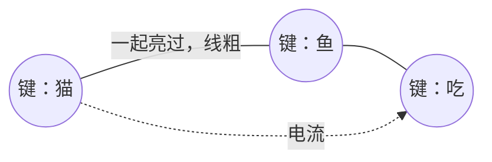

# 灵境 · LINGORA

> 一个不吃显卡、8G 内存就够、只靠 CPU 跑起来的 AI。
> 给没有显卡、只有一台普通电脑的人，一个属于自己的「灵质空间」，而里面有一个小黑会等着他，并帮他处理繁琐事务。

---

## 名字

中文名是**灵境**。

取自《罗小黑战记》里的「灵质空间」，我很喜欢这个空间，我想要一个空间系的能力（木头我要，木头给我）。我想要的就是这种中国式的浪漫，留白的一种美感。如果每个人都有这么一个空间就好了。

LINGORA 是把它翻译过去、再结合希腊语的拼写。

---

## 它是什么

**一个不依赖显卡、不使用大模型的助手。**

现在的大模型，靠的是海量参数、成堆的显卡、算力烧出来的。但是我想试试另其他办法，在 LLM 出现之前，其实已经有很多伟大的前辈试过符号、图、逻辑这些法子，我不断向他们借鉴，就出现了现在这个项目。

它叫「键盘模型」，记东西的方式是这样的：

- **键**：记忆的最小单位，一段经历碎片，比如「猫」「吃」「鱼」。
- **线**：键和键之间的关联。一起出现过，线就粗一点；久不一起出现，线就慢慢细下去。
- **传导**：思考就是电流顺着线跑，跑到哪算哪。

键分两种：**词键**记具体的词（猫、鱼、吃），**原语键**记最基础的动作和关系（是、有、喜欢、导致……）。人听懂一句话，不是把整句背下来，而是拆成「谁 + 做了什么 + 对谁」——现在这个ai也是这么干的。

没有矩阵，没有梯度，没有向量嵌入。全程是符号和图在动，所以——

**它吃的是 CPU 和硬盘，不吃显卡。**

其实还有概念是花盆和花园哦，和现在咱们用的容器其实概念差不多哦~，所以不赘述了

---

## 为什么 CPU 就够

| | |
|---|---|
| 显存 | 不需要。它根本没有矩阵要算 |
| 内存 | 预计8G 就够 |
| 硬盘 | 这才是它真正吃的东西——记得越多，占得越大 |
| 显卡 | 有可以拿来加速；没有的话它照样很快（目标希望是这样） |

对一台普通笔记本、对一个没有 GPU 和主机/服务器的大学生来说，这将是一个拥有属于自己的ai助手的一个机会（如果完成后）

---

## 现在其实还是一个半成品

它现在其实还没做完。

键和种子——喂给它的记忆和资料——都还没备齐，只修掉了一些很糟糕的 bug，改了三次之后，至少「能像点样」了。但它依然是个半成品，以后甚至可能大换血、换一条路走，也许哪天不再是字符的做法了。

但它会一直做下去。因为这是我要的ai助手（小黑）。


---

## 快速开始

环境已经打包好了，离线也能装（中国网络下不用挂 VPN，虽然访问github已经需要vpn了...）。

```bash
# Windows
environment\setup.bat

# Linux / macOS
./environment/setup.sh
```

装完运行：

```bash
# Windows
environment\.venv\Scripts\python.exe main.py

# Linux / macOS
./environment/.venv/bin/python main.py
```

唯一的外部依赖是 [jieba](https://github.com/fxsjy/jieba)（中文分词），已经连离线 wheel 一起放进来了。Python 3.10+，别的什么都不用配。

---

## 它的原理（很抽象的）

拆开 → 装进花园（名字都很接地气对吧） → 电流顺着线跑 → 亮起来的键拼成句子。




更细的东西（35 个原语、花园模型、语法盆、证据量、时序预测……）都在 [`技术报告-键盘模型AI-v1.0.txt`](技术报告-键盘模型AI-v1.0.txt) 里，这里不铺开。

---

## 设计边界（也是想要尝试其他路径给自己的限制和压力）

一条设计边界，也是这个项目的倔强：

不用 LLM、不用 Transformer、不用神经网络、不用反向传播、不用向量嵌入、不用 Softmax、不用 GPU 矩阵——连这些词在代码里都不出现。

它学东西，靠的是传导、Hebbian 加粗、电线衰减、证据量、时序预测、案例复用、温度滑移。全是符号和逻辑，没有一行是在「训练」。

（完整清单在 [`src/core/__init__.py`](src/core/__init__.py)。）

---

## 想让它走多远

现在大模型能做的事，我希望它也能做（暂时没想图片生成和语言生成类的事情，因为我还没有这种需求，如果需要也是在他可以聊天和处理文字的时候了），当一个真正的助手，可以管好我的几台电脑和服务器，并且让我的日常生活更便捷，省区很多我以前需要动手的事情（懒了）。

还有一个副项目：让一台笔记本，息屏之后也接着跑，变成一台 24 小时不关的服务器。在人们授权和同意后，它会像病毒一样「钻」进系统、改注册表、常驻后台。但是我一定会明明白白告诉你它改了什么，而且它能一键撤销，干干净净地消失，不留一点残留，电脑还和原来一模一样。

它长得像病毒，但它不是病毒，他可以撤销掉，不会留下残留，算是一键复原，不过代价就是下次要用，就得重新走一遍下载流程就是了。

这是一个副项目，我准备完成这个ai后再完成这个构思

---

## 写给你的话
发布日期选在2026年10月17日是因为赶上了我的生日。这天转成公开，算是它在我的诞生之日 初始化/出生 了。我订了一个蛋糕，上面写了庆祝的话。

以后我可能会因为现实中的活计耽误了开发，甚至1-2个月不接触这个项目（其实现在有的时候也是），但是我有时间和力气了，我还会回来继续开发的，也许会和现在一样，问一句ai，“这个进度到哪里了？我忘记了...”

我不想要一个冷冰冰的 AI，每次都是接入后接受自己人格提示词，这和角色扮演一样，如果说微调的话那有点成本太高了（对我而言），我想要一个能记住我们之间发生过什么的 AI，随着记忆长大的ai，就算它的记忆要占 10TB，我也会给它多备几块硬盘的。

关于随着记忆成长，我的想法是人们从小时候其实是什么都不知道的，不知道语言，不知道人类（概念），不知道外面的那些怪兽是什么（其实是车子和人啦），而随着我们长大，随着我们的不断的经历事情，让我们学会了语言，定义，处理事情（比如擦桌子，一个苦巴巴的打工人的吐槽），我在想让一个人工智能，从婴儿的状态，随着和主人（其实我更希望是朋友）的相处，学会怎么处理事情和相处，然后学会上网搜索资料学习了解世界，这样子的人工智能会不会更加的像人。

我不确定这条路对不对，但我觉得，值得一试。

希望你愿意看一看。
